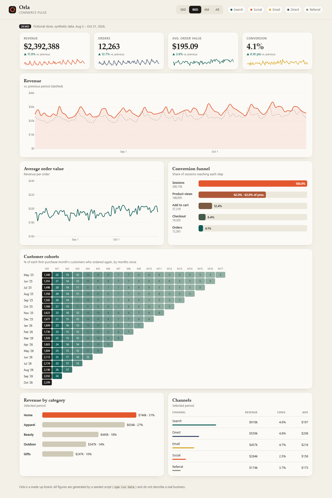
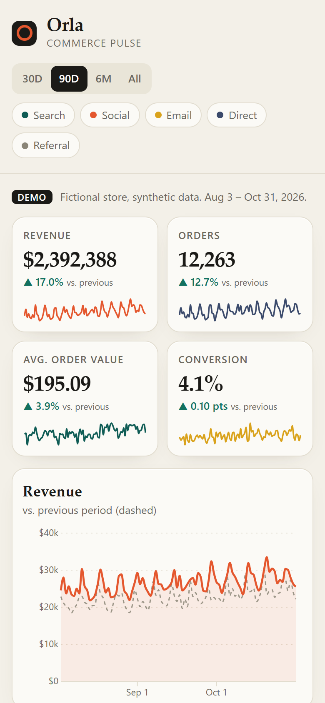

# Vela Commerce Pulse

An e-commerce analytics dashboard: revenue, average order value (AOV), conversion funnel, channel mix and customer cohort retention. Built with **D3 (vanilla JS) + Vite**, no framework.

**Live demo:** https://alissonlittig.github.io/orla-commerce-dashboard/

> Vela is a fictional brand. All data is synthetic, generated by a seeded script. It does not describe a real business or real customers.

| Desktop | Mobile (390 px) |
|---|---|
|  |  |

## Features
- KPI cards with period-over-period deltas and sparklines (revenue, orders, AOV, conversion).
- Revenue chart with the previous period overlaid; AOV trend; hover tooltips.
- Conversion funnel (sessions → views → cart → checkout → orders) with step-to-step rates.
- Cohort retention heatmap (18 monthly cohorts × months since first purchase).
- Date range (30D / 90D / 6M / All) and channel filters; revenue by category; channel table.
- Responsive down to 390 px with no page-level horizontal scroll (the cohort grid scrolls inside its card).

## Run it
```bash
npm install
npm run data    # regenerate public/data.json (deterministic, seeded)
npm test        # metric helpers: node:test
npm run dev
npm run build
```

## Structure
- `scripts/generate-data.mjs` – seeded synthetic data (daily rows per channel, category mix, cohorts).
- `src/metrics.js` – pure functions (filtering, totals, previous period, series, funnel) with tests in `test/`.
- `src/main.js` – D3 rendering and interactions.
- `.github/workflows/pages.yml` – CI (tests + build) and deployment to GitHub Pages.

Known simplification: with a channel filter on, the category chart scales the totals proportionally, because the synthetic data has no category-by-channel breakdown.
